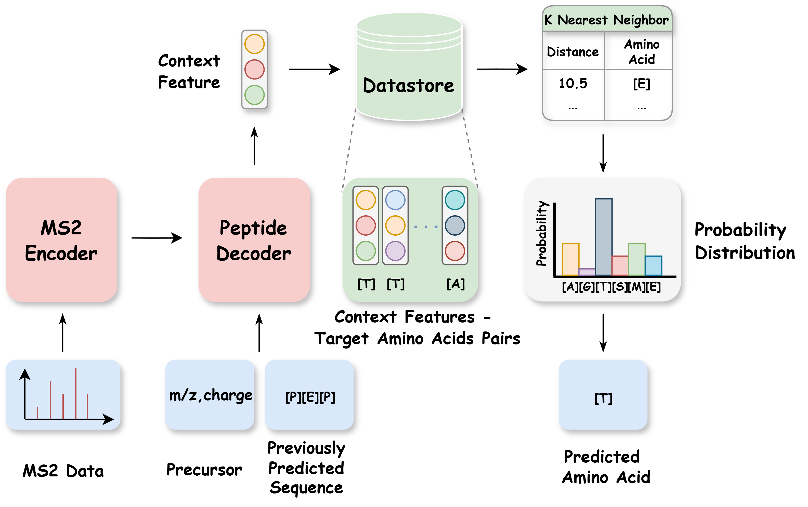
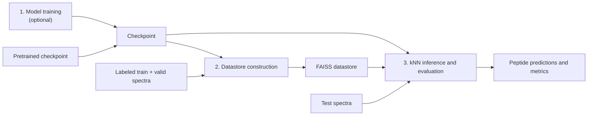

# ReNovo

**Official implementation of “ReNovo: Retrieval-Based *De Novo* Mass Spectrometry Peptide Sequencing” (ICLR 2025).**

[Paper](https://openreview.net/pdf?id=uQnvYP7yX9) · [OpenReview](https://openreview.net/forum?id=uQnvYP7yX9) · [Code](https://github.com/TreeNode147/ReNovo-public) · [Releases](https://github.com/TreeNode147/ReNovo-public/releases) · [Installation](#installation-and-data) · [Reproduction](#reproducing-renovo) · [Citation](#citation) · [License](#license-and-acknowledgements)

ReNovo identifies peptide sequences from tandem mass spectra through retrieval-augmented *de novo* sequencing. It constructs a datastore of context representations and target amino acids from labeled spectra, then retrieves relevant examples to guide each prediction. This combines the assistance of a datastore with the ability to generate novel peptides absent from existing peptide databases. The paper reports improvements over state-of-the-art methods across multiple benchmarks, with modest additional storage and computation.



**ReNovo framework.** The decoder uses the encoded MS2 spectrum, precursor information, and previously predicted sequence to form a context feature. This feature retrieves similar contexts and their target amino acids from the datastore, providing retrieval evidence for predicting the next amino acid.

To reproduce ReNovo on the paper's nine-species dataset, download the supplied dataset and pretrained checkpoint, then follow **Stages 2–3** to build the datastore locally and run inference. Training from scratch in Stage 1 is optional. The commands below use the provided `nine_species/exc_sa` split and official pretrained checkpoint; paper-reported results are listed in Stage 3 as a reference for reproduction.

## Installation and data

Clone the `v0.2.0` release and enter its root directory. This pins the source
code and this README to the same version as the reproduction assets:

```bash
git clone --branch v0.2.0 --depth 1 "https://github.com/TreeNode147/ReNovo-public.git" ReNovo
cd ReNovo
```

Alternatively, download **Source code (zip)** or **Source code (tar.gz)** from
[Release v0.2.0](https://github.com/TreeNode147/ReNovo-public/releases/tag/v0.2.0), extract
the archive, and enter its root directory. Both archives contain the same
versioned source and README; download the dataset and checkpoint separately below.

### 1. Create the Conda environment

Use **Linux x86_64**, Conda, and an NVIDIA GPU with a driver compatible with CUDA 12.1. Run all commands from the repository root, where `environment.yaml` is located.

```bash
conda env create --file environment.yaml
conda activate renovo
```

The pinned environment includes:

| Component | Version |
| :--- | :--- |
| Python | 3.10.14 |
| PyTorch / CUDA runtime | 2.1.2 / 12.1 |
| FAISS GPU | 1.8.0 |
| Lightning | 2.1.3 |
| NumPy | 1.26.4 |
| depthcharge-ms | 0.2.3 |

Conda creates the named `renovo` environment in its managed environment directory.
The repository does not bundle an installed environment or local wheels; all
dependencies are installed from the channels and package index in
`environment.yaml`. The launch scripts use `python` from the active environment.
An explicit interpreter can optionally be selected with `RENOVO_PYTHON`.

Check the environment before starting an experiment:

```bash
python -m pip check
python - <<'PY'
import torch
import faiss
from depthcharge.components.transformers import _PeptideTransformer

assert torch.cuda.is_available(), "PyTorch cannot access a CUDA device."
assert faiss.get_num_gpus() > 0, "FAISS cannot access a GPU."
print(f"PyTorch {torch.__version__}; FAISS {faiss.__version__}")
PY
```

Installation is a one-time step. Activate `renovo` whenever you open a new shell
to run the commands below.

### 2. Download the reproduction assets

The dataset and pretrained checkpoint are distributed as [Release v0.2.0 assets](https://github.com/TreeNode147/ReNovo-public/releases/tag/v0.2.0), separately from Git. Datastores are generated locally in Stage 2 and are not distributed as release attachments:

| Release asset | Local destination | Purpose |
| :--- | :--- | :--- |
| `train.mgf.gz` | `dataset/nine_species/exc_sa/train.mgf` | Gzip-compressed training split for training and datastore construction |
| `valid.mgf` | `dataset/nine_species/exc_sa/valid.mgf` | Training validation and datastore construction |
| `test.mgf` | `dataset/nine_species/exc_sa/test.mgf` | Evaluation |
| `ReNovo_for_9species` | `saved_model/ReNovo_for_9species` | Official checkpoint for reproducing ReNovo results on the nine-species dataset (`exc_sa` split) |
| `SHA256SUMS` | Keep beside the downloaded assets | SHA-256 checksums for the four downloaded dataset and checkpoint assets |

The training split is compressed for download. Decompressing `train.mgf.gz`
produces the original `train.mgf` used by the experiments.

Download the assets in your browser or use the [GitHub CLI](https://cli.github.com/manual/gh_release_download). If the CLI requests authentication, run `gh auth login`. Run the following from a fresh clone of this repository:

```bash
RENOVO_REPO="TreeNode147/ReNovo-public"
RENOVO_ASSET_TAG="v0.2.0"
DOWNLOAD_DIR="$(mktemp -d)"

gh release download "$RENOVO_ASSET_TAG" \
  --repo "$RENOVO_REPO" \
  --dir "$DOWNLOAD_DIR"

(
  cd "$DOWNLOAD_DIR"
  sha256sum --check SHA256SUMS
)
```

Continue once all four downloaded files report `OK`. Decompress the training split
and place the inputs in the expected directories:

```bash
mkdir -p dataset/nine_species/exc_sa saved_model
gzip -dc "$DOWNLOAD_DIR/train.mgf.gz" > dataset/nine_species/exc_sa/train.mgf
cp "$DOWNLOAD_DIR/valid.mgf" "$DOWNLOAD_DIR/test.mgf" dataset/nine_species/exc_sa/
cp "$DOWNLOAD_DIR/ReNovo_for_9species" saved_model/
```

Next, use the pretrained checkpoint with `train.mgf` and `valid.mgf` to build
the datastore in **Stage 2**, then evaluate in **Stage 3**. The build generates
`config.json`, `keys.npy`, `vals.npy`, and `keys.faiss_index`. The raw feature
array alone occupies approximately 17.32 GB; see Stage 2 for storage requirements.

The expected directory structure after downloading the inputs and building the datastore is:

```text
.
├── environment.yaml
├── renovo/
│   ├── cli.py                     # Command line interface: python -m renovo
│   ├── sh_file/                   # Training, build, and evaluation launchers
│   └── yaml_file/                 # Stage-specific configurations
├── logs/model/                    # Created automatically when a stage runs
├── dataset/nine_species/exc_sa/
│   ├── train.mgf                  # 499,402 spectra
│   ├── valid.mgf                  #  28,572 spectra
│   └── test.mgf                   #  27,142 spectra
├── saved_model/
│   └── ReNovo_for_9species
└── datastore/                     # Generated locally in Stage 2
    └── renovo_sa_db/              # Default RUN_NAME: renovo_sa
```

MGF files include ground-truth peptide annotations in their `SEQ=` fields. The provided dataset occupies approximately 1.58 GB, and the checkpoint approximately 569 MB, before compression.

<details>
<summary>Verify the downloaded dataset and checkpoint</summary>

Run this command from the repository root to check the four assets against their
recorded SHA-256 hashes:

```bash
sha256sum --check <<'SHA256'
820f25c7f242dca5340d5c7a8281da65911612395f02f2ea47cbfbad3cc09677  dataset/nine_species/exc_sa/train.mgf
34d608b431fe4ade96904d782136687633fea47e4361ca809c62cdcdd654a5e6  dataset/nine_species/exc_sa/valid.mgf
3af8c104ca3544b713555fe81852db099e13179c2f643c3245a0241d1c551976  dataset/nine_species/exc_sa/test.mgf
a57c1be433eba7482f97f68c32d27af5218e01fc2e9dc23ef5dcb1c0514466af  saved_model/ReNovo_for_9species
SHA256
```

</details>

## Reproducing ReNovo



The Python package and command line entry point are named `renovo`. From the
repository root, view the available commands with:

```bash
python -m renovo --help
```

Set the experiment paths once, and run the stages below in the same shell:

```bash
PROJECT_ROOT="$PWD"
DATA_DIR="$PROJECT_ROOT/dataset/nine_species/exc_sa"
CKPT="$PROJECT_ROOT/saved_model/ReNovo_for_9species"
RUN_NAME="renovo_sa"
```

### Stage 1 — Train from scratch (optional)

Skip this stage to use the downloaded checkpoint. To train a new model, create a training configuration with a separate checkpoint directory:

```bash
python - <<'PY'
from pathlib import Path
import yaml

folder = Path("renovo/yaml_file")
config = yaml.safe_load((folder / "train_v2.yaml").read_text())
config["train_from_scratch"] = True
config["model_save_folder_path"] = "saved_model/retrained"
(folder / "train_from_scratch.yaml").write_text(
    yaml.safe_dump(config, sort_keys=False)
)
PY

bash renovo/sh_file/train_v2.sh \
  sa \
  renovo_sa_train \
  "$PROJECT_ROOT/renovo/yaml_file/train_from_scratch.yaml"
```

The first argument, `sa`, selects `dataset/nine_species/exc_sa/`.

| Item | Description |
| :--- | :--- |
| Inputs | `train.mgf`, `valid.mgf`, and the training YAML |
| Model | Transformer encoder–decoder; 512 hidden dimensions, 8 attention heads, 9 layers in each component |
| Training | Adam; learning rate `5e-4`; batch size `32`; dropout `0.03`; up to `50` epochs |
| Checkpoint selection | Validation after each epoch; retain the 5 checkpoints with the lowest `valid_CELoss` |
| Outputs | `saved_model/retrained/*.ckpt` and `logs/model/renovo_sa_train.log` |

After training, select the checkpoint with the lowest validation loss and update the variables before continuing. Replace `SELECTED_CHECKPOINT.ckpt` with its actual filename:

```bash
CKPT="$PROJECT_ROOT/saved_model/retrained/SELECTED_CHECKPOINT.ckpt"
RUN_NAME="renovo_sa_retrained"
```

**Use the same checkpoint for datastore construction and inference.** A newly trained checkpoint requires its own datastore; the provided checkpoint and a new training run need not produce identical results.

### Stage 2 — Build the kNN datastore

By default, this stage uses the downloaded `ReNovo_for_9species` pretrained checkpoint. The model uses teacher forcing on **train + valid** to store decoder context vectors and their target token IDs. The test split is excluded from datastore construction. FAISS then builds an index over these vectors.

Choose a fresh `RUN_NAME` for each datastore. If the destination already exists, retain it and choose another name before running the build command.

```bash
DATASTORE_DIR="$PROJECT_ROOT/datastore/${RUN_NAME}_db"

bash renovo/sh_file/knn_build.sh \
  "$DATA_DIR" \
  "$RUN_NAME" \
  "$CKPT" \
  "$PROJECT_ROOT/renovo/yaml_file/knn_build_9spec.yaml" \
  "${RUN_NAME}_build"
```

| Input | Description |
| :--- | :--- |
| `$DATA_DIR/train.mgf` + `$DATA_DIR/valid.mgf` | 527,974 annotated spectra for the provided split |
| `$CKPT` | Downloaded checkpoint or the checkpoint selected in Stage 1 |
| `knn_build_9spec.yaml` | Spectrum preprocessing and model execution settings |

The datastore is written to `$DATASTORE_DIR`:

| Output | Contents | Size for the supplied checkpoint and split |
| :--- | :--- | ---: |
| `keys.npy` | 8,456,240 context vectors, each with 512 float32 values | 17.32 GB |
| `vals.npy` | Corresponding target token IDs | 67.65 MB |
| `keys.faiss_index` | FAISS IVF-PQ search index | 617.80 MB |
| `config.json` | Array shapes and data types | < 1 KB |

The model log is saved to `logs/model/${RUN_NAME}_build.log`. Index construction uses L2 distance, 4,096 centroids and 64 PQ subspaces; search uses `nprobe=32`.

Allow space for the datastore **and an additional copy during inference**: the current evaluation CLI copies the datastore into `tmp/`. The `.npy` datastore files are raw memory-mapped arrays; use their recorded shapes and data types rather than `numpy.load` to read them.

### Stage 3 — Run kNN inference and evaluation

Evaluate the test spectra using the checkpoint and datastore from the preceding stages:

```bash
bash renovo/sh_file/knn_infer.sh \
  "$DATA_DIR" \
  "$DATASTORE_DIR" \
  "$CKPT" \
  "$PROJECT_ROOT/renovo/yaml_file/knn_infer_79spec.yaml" \
  "${RUN_NAME}_knn" \
  64 \
  7
```

The last two arguments are the **number of neighbors** (`k=64`) and **retrieval temperature** (`7`). The filename `knn_infer_79spec.yaml` is retained from the implementation; the command above explicitly evaluates `$DATA_DIR/test.mgf`.

| Setting | Default |
| :--- | :--- |
| Evaluation batch size | 1,024 |
| Beam width / returned matches | 5 / 1 |
| Peptide length | 5–65 |
| Precursor mass tolerance | 50 ppm |
| Isotope error range | `[0, 1]` |
| Random seed | 454 |

**Inputs:** `test.mgf`, `$CKPT`, `$DATASTORE_DIR`, and the inference YAML. Ground-truth annotations are used to calculate evaluation metrics.

**Outputs:** the terminal summary and `logs/model/${RUN_NAME}_knn.log`, containing peptide precision, peptide AUC, amino-acid precision, amino-acid recall, and loss. This evaluation entry point reports aggregate metrics; it does not export a per-spectrum prediction file.

**Paper-reported results (nine-species dataset).** Use the following values
from the paper as the reference for reproduction:

| Metric | Paper-reported value |
| :--- | ---: |
| Peptide precision | 0.568 |
| Peptide AUC | 0.528 |
| Amino-acid (AA) precision | 0.770 |
| Amino-acid (AA) recall | 0.769 |

To reuse a locally built datastore in a new shell, restore the experiment
variables defined above, including the matching `CKPT` and `RUN_NAME`, and
set `DATASTORE_DIR` to the existing datastore:

```bash
DATASTORE_DIR="$PROJECT_ROOT/datastore/${RUN_NAME}_db"
```

Then run the Stage 3 command. Datastores are excluded from Git and release
attachments; a fresh clone must complete Stage 2 before inference.

<details>
<summary>Use an existing local reference index (optional)</summary>

If you already have a reference datastore built with the supplied pretrained
checkpoint, you can use it for comparisons. It must contain `config.json`,
`vals.npy`, and `keys.faiss_index`; the original context-vector file is not
needed to query the index. Keeping a fixed FAISS index can help compare runs,
because rebuilding an approximate index can change neighbors and predictions.

For example, if your existing reference index is stored at
`reference_datastore/9spec_6_2_db`, select the supplied checkpoint, set the
following path, and run the same Stage 3 command:

```bash
DATASTORE_DIR="$PROJECT_ROOT/reference_datastore/9spec_6_2_db"
```

This reuses the preserved index with the same inference workflow. The reference
index is optional and is not distributed through Git or release attachments.
Stage 2 writes to `datastore/${RUN_NAME}_db`; it does not create this separate
reference directory.

</details>

<details>
<summary>Evaluation settings and reproducibility notes</summary>

- Keep the provided split, checkpoint, vocabulary, preprocessing, retrieval settings, and decoding settings fixed when comparing runs. Select hyperparameters using validation data, and keep test spectra out of the datastore.
- Metrics are calculated within each batch and then aggregated by Lightning. In particular, peptide AUC is not calculated by sorting the entire test set globally. Reducing `predict_batch_size` can help with GPU memory, but it changes the grouping used for metric aggregation; record the change when comparing results.
- Evaluation reuses Lightning’s validation interface, so `Valid loss` refers to the test-set loss in this command. The kNN path passes fused scores to cross-entropy; interpret this loss according to the implementation.
- Checkpoint training, GPU arithmetic, and FAISS index construction can introduce differences between runs. Record the environment, code revision, checkpoint, configuration, and datastore used for each reported result.

</details>

### Log organization

The stage launchers create log directories automatically:

| Location | Contents |
| :--- | :--- |
| `logs/model/` | Model logs produced by the three stage launchers |
| `logs/lightning_logs/` | Lightning/TensorBoard logs generated during execution |

Run logs and temporary files are ignored by Git. Use a distinct `RUN_NAME` for
each experiment, and retain the resulting logs with the corresponding
checkpoint, datastore, and configuration when reporting results.

## Citation

If ReNovo is useful in your research, please cite our [ICLR 2025 paper](https://openreview.net/forum?id=uQnvYP7yX9):

```bibtex
@inproceedings{chen2025renovo,
  title     = {ReNovo: Retrieval-Based {De Novo} Mass Spectrometry Peptide Sequencing},
  author    = {Shaorong Chen and Jun Xia and Jingbo Zhou and Lecheng Zhang and
               Zhangyang Gao and Bozhen Hu and Cheng Tan and Wenjie Du and Stan Z. Li},
  booktitle = {The Thirteenth International Conference on Learning Representations},
  year      = {2025},
  url       = {https://openreview.net/forum?id=uQnvYP7yX9}
}
```

## License and acknowledgements

ReNovo's original code and modifications are released under the
[Apache License 2.0](LICENSE), following Casanovo's licensing approach.
Third-party portions retain their original licenses and copyright notices.

We acknowledge [Casanovo](https://github.com/Noble-Lab/casanovo) and
[Depthcharge](https://github.com/wfondrie/depthcharge) for the sequencing and
mass-spectrometry components, [kNN-box](https://github.com/NJUNLP/knn-box) for
datastore and retrieval utilities, [kNN-LM](https://github.com/urvashik/knnlm)
for the index-building approach acknowledged by those utilities, and
[FAISS](https://github.com/facebookresearch/faiss) for vector search.

Upstream license texts are included in [licenses/](licenses/).
